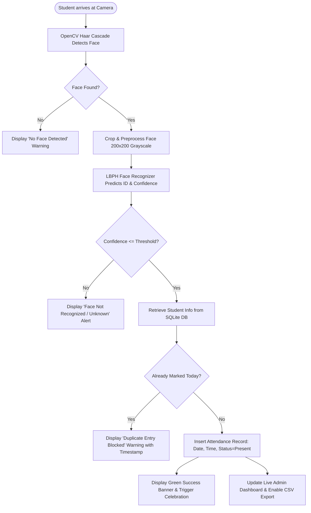

# 🎓 AI Based Smart Attendance Management System
> **A complete, beginner-friendly Computer Vision & Machine Learning Mini-Project designed for B.Tech / BE Students.**


---

## 📌 Project Overview
The **AI Based Smart Attendance Management System** replaces traditional, manual paper registers with an automated, contactless biometric solution. Using a standard camera, the system detects a student's face, verifies their identity using the **Local Binary Patterns Histograms (LBPH)** algorithm, and records their attendance with exact date and timestamp in an **SQLite** database.

### 🌟 Key Requirements Met
1. **Student Registration**: Register students with Name, Roll Number, Department, and face sample captures.
2. **OpenCV Powered**: Uses OpenCV Haar Cascade for face detection and OpenCV LBPH Face Recognizer for training and classification.
3. **Automatic Attendance**: Automatically logs Name, Roll Number, Department, Date, and Time.
4. **Duplicate Prevention**: Strictly blocks multiple attendance entries for the same student on the same day (enforced in both application logic and SQLite schema).
5. **SQLite Database**: Persistent, lightweight, zero-configuration database (`attendance.db`).
6. **Admin Dashboard**: Live statistics, interactive attendance logs, and student directory.
7. **CSV Export**: One-click download of attendance reports filtered by date or department.
8. **Streamlit UI**: Clean, interactive, responsive web interface.
9. **Instant Feedback**: Colored alert banners (`st.success`, `st.warning`, `st.error`, `st.info`) and celebration animations.
10. **Modular Architecture**: Clean separation into `app.py`, `database.py`, and `face_utils.py`.

---

## 🏛️ System Architecture

The project follows a **4-Layer Modular Architecture**:

```
+-------------------------------------------------------------------------+
|                        1. USER INTERFACE LAYER                          |
|  Streamlit Web Dashboard (Registration, Live Scanner, Analytics, CSV)   |
+-------------------------------------------------------------------------+
                                    |
                                    v
+-------------------------------------------------------------------------+
|                    2. CONTROLLER & BUSINESS LOGIC                       |
|           app.py (Form Validation, Duplicate Attendance Rules)          |
+-------------------------------------------------------------------------+
                  |                                     |
                  v                                     v
+-----------------------------------+ +-----------------------------------+
|      3. VISION & AI ENGINE        | |          4. DATA LAYER            |
|          (face_utils.py)          | |          (database.py)            |
| • Haar Cascade (Face Detection)   | | • SQLite Database (attendance.db) |
| • Histogram Equalization & Crop   | | • students & attendance tables    |
| • LBPH Classifier (Training & ML) | | • UNIQUE(roll_number, date) check |
| • Model Weights (models/*.yml)    | | • CSV Report Generation (pandas)  |
+-----------------------------------+ +-----------------------------------+
```

### 🔄 Data Flow Workflow


---

## 📁 Directory & Folder Structure

```
d:/IPE/
│
├── app.py                      # Streamlit UI controller (Multi-page views, forms, camera scanner)
├── flask_app.py                # Flask REST API backend service (Login, Attendance, Reports, CRUD)
├── database.py                 # SQLite database layer (Schema, CRUD, duplicate check, stats, auth)
├── face_utils.py               # OpenCV face detection, dataset capture, LBPH training, recognition
├── test_face_module.py         # Automated test suite (7 complete test cases & live camera diagnostics)
├── requirements.txt            # Python dependencies (Streamlit, Flask, OpenCV Contrib, etc.)
├── README.md                   # Comprehensive project guide and documentation
├── .gitignore                  # Git ignore rules for bytecode, cache, and virtual environments
│
├── data/                       # Data storage directory
│   ├── attendance.db           # SQLite database file (automatically created on first run)
│   └── dataset/                # Extracted face images categorized by student ID
│       ├── student_1/          # Grayscale 200x200 face samples for Student #1
│       └── student_2/          # Grayscale 200x200 face samples for Student #2
│
└── models/                     # Trained ML model weights directory
    └── trained_lbph_model.yml  # Serialized LBPH model weights generated by OpenCV
```

---

## 🗄️ Database Schema (SQLite)

### Table 1: `students`
| Column | Type | Constraints | Description |
| :--- | :--- | :--- | :--- |
| `id` | `INTEGER` | `PRIMARY KEY AUTOINCREMENT` | Unique internal numerical ID (used as LBPH label) |
| `roll_number` | `TEXT` | `UNIQUE NOT NULL` | Student College Roll Number / Hall Ticket No |
| `name` | `TEXT` | `NOT NULL` | Full Name of the student |
| `department` | `TEXT` | `NOT NULL` | Department (CSE, IT, ECE, AI&DS, etc.) |
| `registered_at`| `TEXT` | `NOT NULL` | Registration timestamp (`YYYY-MM-DD HH:MM:SS`) |

### Table 2: `attendance`
| Column | Type | Constraints | Description |
| :--- | :--- | :--- | :--- |
| `id` | `INTEGER` | `PRIMARY KEY AUTOINCREMENT` | Unique Attendance Log ID |
| `student_id` | `INTEGER` | `FOREIGN KEY (students.id)` | Foreign key linking to student |
| `roll_number` | `TEXT` | `NOT NULL` | Student Roll Number |
| `name` | `TEXT` | `NOT NULL` | Student Name |
| `department` | `TEXT` | `NOT NULL` | Student Department |
| `date` | `TEXT` | `NOT NULL` | Attendance Date (`YYYY-MM-DD`) |
| `time` | `TEXT` | `NOT NULL` | Attendance Time (`HH:MM:SS AM/PM`) |
| `status` | `TEXT` | `DEFAULT 'Present'` | Attendance Status |

> **Duplicate Prevention Rule**: 
> A composite `UNIQUE(roll_number, date)` constraint is enforced inside the database schema, along with an explicit verification check in `database.py` before insertion. This makes it impossible for a student to receive duplicate entries on the same day.

---

## 💻 Prerequisites & Installation Guide

### Step 1: Install Python (If not already installed)
Make sure Python (version 3.8 to 3.11) is installed and added to your system's `PATH`.

On Windows PowerShell:
```powershell
winget install Python.Python.3.11
```
*Note: During manual installation from python.org, remember to check the box **"Add python.exe to PATH"**.*

Verify installation:
```powershell
python --version
```

---

### Step 2: Open Project in VS Code
1. Launch **Visual Studio Code**.
2. Go to **File -> Open Folder...** and select the project folder: `d:\IPE`.
3. Open the built-in terminal in VS Code: `Ctrl + ~` (or **Terminal -> New Terminal**).

---

### Step 3: Create & Activate a Virtual Environment (Recommended)
Creating a virtual environment ensures dependencies do not conflict with other Python projects:

```powershell
# Create virtual environment named 'venv'
python -m venv venv

# Activate on Windows PowerShell
.\venv\Scripts\Activate.ps1
```
*(If you see an execution policy error on PowerShell, run `Set-ExecutionPolicy -Scope Process -ExecutionPolicy Bypass` first).*

---

### Step 4: Install Dependencies
Run the following command to install all required libraries:

```powershell
pip install -r requirements.txt
```

> ⚠️ **Important Note on OpenCV**: 
> Notice that `requirements.txt` specifies `opencv-contrib-python`, **NOT** the standard `opencv-python`. The standard package does not contain the `cv2.face` module needed for `cv2.face.LBPHFaceRecognizer_create()`.

---

## 🚀 How to Run the Application

### Mode 1: Streamlit Interactive Web Application (Primary UI)
In your VS Code terminal (with virtual environment activated):

```powershell
streamlit run app.py
```
Access the application in your browser at: `http://localhost:8501`

> **Admin Credentials for Protected Sections**:
> * **Username**: `admin`
> * **Password**: `admin123`

---

### Mode 2: Flask REST API Backend Service
To start the Flask backend API server on port 5000:

```powershell
python flask_app.py
```
API endpoint catalog is available at: `http://127.0.0.1:5000/`

---

## 🧪 How to Test the Face Recognition Module

The system provides **three methods** to test and verify face detection, lighting diagnostics, and confidence gating:

### Option A: Automated CLI Test Suite (Recommended for evaluation)
Run the automated test suite in your VS Code terminal:
```powershell
python test_face_module.py
```
This tests:
1. **OpenCV Contrib & Haar Cascade integrity**: Ensures `cv2.face.LBPHFaceRecognizer_create()` and XML cascade models are loaded correctly.
2. **Quality Diagnostics**: Tests dark images (underexposed), blurry images, and distance errors.
3. **Confidence Threshold & Safety Gate**: Verifies that low-confidence (< 70%) predictions are strictly rejected.
4. **SQLite Duplicate Entry Check**: Verifies that the same student cannot be logged twice on the same day.

### Option B: Interactive Live Webcam Diagnostic Mode
Launch a live camera monitor with real-time brightness, blur, and face centering measurements:
```powershell
python test_face_module.py --webcam
```
*(Press `q` or `ESC` in the camera window to exit).*

### Option C: In-App Diagnostics & Testing Lab (Streamlit UI)
1. In the sidebar, select **🧪 Diagnostics & Testing Lab**.
2. Upload any test picture or take a camera snapshot.
3. Observe the real-time diagnostic meters:
   - **Illumination Level** (e.g., Good vs Too Dark)
   - **Sharpness Score** (e.g., Sharp vs Blurry)
   - **Camera Distance** & **Face Centering**
   - **Match Confidence %** and whether attendance would be approved or blocked.

---

## 📖 Step-by-Step User Guide

### 1. Register a Student
1. Navigate to **📝 Student Registration** in the sidebar.
2. Enter the **Roll Number** (e.g. `21CS001`), **Full Name**, and select their **Department**.
3. Click **"Save Student Details"**.
4. In Section 2, choose **In-Browser Camera Capture** or **Auto Webcam Capture**.
5. Take 1 to 3 clear snapshots (or let the auto-capture take 30 frames).
6. Click **"⚡ Train / Retrain Model Now"**. You will see a success message showing the number of face samples trained.

### 2. Mark Attendance
1. Navigate to **📸 Mark Attendance** in the sidebar.
2. Position your face in front of the camera and click **"Take Photo"**.
3. The system will:
   - Detect face bounding box (in green).
   - Recognize the student identity.
   - If first time today: Display **"Attendance Recorded!"** with celebratory balloons, student details, and timestamp.
   - If already scanned today: Display **"Duplicate Attendance Prevented"** warning with the exact time of the earlier check-in.

### 3. View Reports & Export CSV
1. Navigate to **📊 Admin Dashboard & Reports**.
2. View attendance logs for today or select any custom date.
3. Filter records by Department or search by Student Name / Roll Number.
4. Click **"📥 Download CSV Report"** to export the filtered report for college submission or grading.

---

## 🎓 Viva Voce / Project Defense Q&A

**Q1: Why did you choose Haar Cascade over Deep Learning models for face detection?**
> *Answer*: Haar Cascade is an ultra-lightweight, CPU-friendly algorithm that runs at high frame rates in real-time without requiring expensive GPUs. It uses rectangular features and an AdaBoost cascade classifier, making it ideal for college lab computers and edge devices.

**Q2: How does the LBPH (Local Binary Patterns Histograms) algorithm work?**
> *Answer*: LBPH divides the face into small local circular neighborhoods. For each pixel, it compares its grayscale value with its 8 surrounding neighbors. If a neighbor's value is greater or equal to the center, it assigns 1, else 0. This forms an 8-bit binary pattern for each pixel. Histograms of these patterns are computed across spatial grids, producing a unique feature vector that is invariant to monotonic grayscale changes and lighting shifts.

**Q3: How is duplicate attendance prevented if a student scans their face twice?**
> *Answer*: Duplicate attendance is prevented at two stages:
> 1. **Application Logic**: Before executing the SQL insert query, `database.is_attendance_marked_today()` checks if the student's roll number already exists for today's date (`YYYY-MM-DD`). If found, insertion is aborted and an alert is shown.
> 2. **Database Integrity**: The SQLite `attendance` table has a composite unique constraint `UNIQUE(roll_number, date)` which guarantees at the database engine level that no duplicate records can ever be inserted.

**Q4: Why use SQLite instead of MySQL or PostgreSQL?**
> *Answer*: SQLite is a serverless, zero-configuration, self-contained relational database that stores all data in a single file (`attendance.db`). It requires no background database daemon, making the project portable and easy to run on any computer or evaluators' laptop without external database setup.
